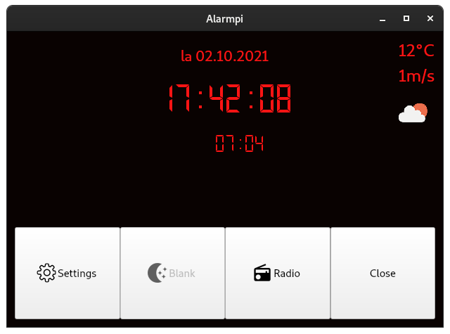
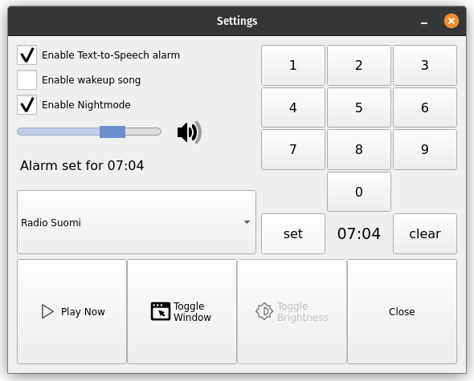

# Alarmpi

[](https://github.com/lajanki/alarmpi/actions/workflows/ci.yml)

A Raspberry Pi clock radio with customizable Text To Speech alarm.

This project is a fork of https://github.com/skiwithpete/alarmpi. It is inteded to work
as a bedside table clock radio and heavly inspired by skiwithpete's
demonstration video on [YouTube](https://youtu.be/julETnOLkaU).


>Good afternoon, it's Wednesday September twelfth. The time is 07:29 PM.
>
>Weather for today is Mostly Cloudy becoming rainy. It is currently 16 degrees  with a fresh breeze. The high for today is 17 and the low at 11 degrees. The sun rises at 06:43 AM and sets at 07:50 PM.
>
>And now, The latest stories from the World section of the BBC News.
>
>EU parliament votes to punish Hungary over 'breaches' of core values.
>The European Parliament votes to punish Hungary for allegedly flouting EU values and the rule of law.
>
>Hurricane Florence: Mass evacuation from 'storm of a lifetime'.
>South Carolina authorities turn four motorways into one-way routes away from the coast.
>
>Morocco bans forced marriage and sexual violence.
>The new law criminalises sexual harassment and imposes tougher penalties on perpetrators.
>
>Sri Lanka to ban Hindu animal sacrifice.
>The ritual killing of animals such as goats could soon be outlawed at Sri Lanka's Hindu temples.
>
>
>Thats all for now. Have a nice day.


## Main Features
 * Alarm scheduling
 * A spoken greeting based on time of day
 * Weather forecast from [openweathermap.org](https://openweathermap.org/)
 * Latest world news from BBC World RSS feed
 * Play internet radio streams
 






## Hardware setup
This project is built around the following hardware.
 * Raspberry Pi
 * [Official Raspberry Pi Touch Display](https://www.raspberrypi.com/products/raspberry-pi-touch-display/)
 * A speaker
 * A DHT22 temperature and humidity sensor (optional)

While this is built for a Rapsberry Pi, other Linux systems can be used for the main functionality. The GUI does have two bindings to a Raspberry Pi; buttons toggling screen brightness and turning it off completely are disabled on a non Pi system.

The DHT22 sensor is used for indoor temperature measurement and can be disabled from the configuration, see [configs/README.md](./configs/README.md).


## Setup
First, install required system packages with  
```bash
sudo apt install qtbase5-dev ffmpeg vlc gpiod
```
These include the core Qt5 development package and some additional utilities for audio processing.

Additionally, [uv](https://docs.astral.sh/uv/getting-started/installation/) is used for project management.

### Installing Python dependecies
The UI framework used is `PyQt5` which is tricky to install on a Raspberry Pi as it has to be compiled from source and includes a GPL license to accept.

To install the dependencies, run
```bash
uv sync --no-install-package PyQt5-Qt5 --config-settings="--confirm-license="
```
The binary-only package `PyQt5-Qt5` contains a `Qt` installation only needed when not building from source. It is also not availaible for ARM architecture.

See the PyQt documentation for more installation instructions:
 * https://www.riverbankcomputing.com/static/Docs/PyQt5/installation.html

> [!IMPORTANT]
> On an older Raspberry Pi model compiling from source can take several hours.

> [!NOTE]
> On a more conventional architecture a default `uv sync` should be enough to install the dependencies.

Interacting with the Raspberry Pi's screen brightness is done via two system owned by the root user. The following udev rule will make them writable by all users (adapted from https://github.com/linusg/rpi-backlight).

```bash
echo 'SUBSYSTEM=="backlight",RUN+="/bin/chmod 666 /sys/class/backlight/%k/brightness /sys/class/backlight/%k/bl_power"' | sudo tee -a /etc/udev/rules.d/backlight-permissions.rules
```


## Usage
Run the script either with
```bash
uv run --no-sync alarmpi [configuration_file]
```
where `[configuration_file]` is a path to a custom alarm configuration file, eg.
```bash
uv run --no-sync alarmpi ~/alarm_config.yaml
```
If no argument is used the default configuration in, [./configs/default.yaml](./configs/default.yaml) will be used.

The optional configuration file can be used to customize the alarm as well as additional plugin based functionality, see [configs/README.md](./configs/README.md) for instructions.

You can also run a purely CLI version of the alarm with
```bash
uv run tools/play_alarm.py [configuration_file]
```

### Note about locales
While the TTS alarm is played in English, weekday and month names will be generated according to the runtime environment's current locale. If necessary, the relevant locale setting can be set to English with something like:
```bash
LC_TIME=en_GB.utf8 uv run alarmpi
```

## Unit tests
Unit tests can be run from the root folder with
```bash
uv run pytest
```
